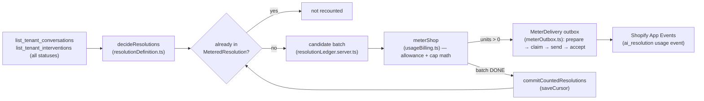

# Billing — AI-resolution metering (#19)

App issue #19 closed the LAST gap the 2026-09-11 review found:
`usageBilling.ts` used to read `get_tenant_usage` as if it returned a
`{ resolutions, cursor }` pair; that tool actually returns tenant entity counts,
so usage was permanently unreadable and every batch held forever. This doc
records the fix as the single source of truth for the billing definition and
pipeline — read it before changing anything under `app/lib/{resolution,meter,
usage}*`.

## The definition (boss default, 2026-09-13)

> **A billable AI resolution is a visitor conversation the assistant answered
> that ended WITHOUT a human hand-off, and was NOT reopened by the same
> visitor within 24 hours.**

Implemented, pure and unit-tested, in `app/lib/resolutionDefinition.ts`
(`decideResolutions` / `RESOLUTION_DEFINITION`). It is also shown verbatim on
the merchant's Billing page (`app/routes/app.billing.tsx`) next to the
current-cycle count.

Three inputs decide each conversation, from a single MCP snapshot (no diffing
across runs needed — see "why one snapshot suffices" below):

| Signal | Source | Disqualifies when |
|---|---|---|
| Still live | `list_tenant_conversations` (`live`) | `live === true` — not ended yet |
| Human hand-off | `list_tenant_interventions`, ANY status (`listTenantInterventionsAll`) | any intervention row references the session — open, resolved, or declined all count; the Conversations-page inbox (`listTenantHandoffs`) only shows OPEN ones, a different, narrower read |
| Reopened within 24h | `list_tenant_conversations` (`lastActiveAt`) | `now − lastActiveAt < 24h` |

**Why one snapshot suffices for "not reopened within 24h":** `lastActiveAt`
only ever advances when another turn is added to that session. So "no activity
in the last 24h" (one read, one timestamp compare) and "not reopened within
24h of ending" (would need to diff two reads) are the same fact. A
conversation still inside the 24h window is not yet decidable and is simply
re-checked on the next scan — never guessed either way (fail-closed).

## The pipeline

1. **Producer** (`app/lib/resolutionLedger.server.ts`, `readNewResolutions`):
   reads conversations + hand-offs via MCP, applies the definition, and drops
   any session already in the `MeteredResolution` ledger. Returns a *candidate*
   batch — it does **not** write yet.
2. **Idempotent commit boundary** (`MeteredResolution`, `@@unique([tenantId,
   sessionId])`): a session is permanently counted **at most once, ever**,
   however many times the rolling `list_tenant_conversations` window re-surfaces
   it. Committed only once a batch is DONE — see "retry safety" below.
3. **Allowance / cap math** (`usageBilling.meterShop` + `plans.computeUsageReport`):
   reports every post-trial resolution of the cycle (Shopify's free first tier
   is the included allowance), never past the cap ceiling; trial usage is never
   reported. See "Allowance, cap and trial" below. The widget is never disabled.
4. **Durable delivery** (`app/lib/meterOutbox.ts`, `MeterDelivery` table): a
   billable batch is `prepare`d (immutable, per-shop-locked, one pending batch
   at a time — protects against overlapping timer + page-load metering),
   `claim`ed (30s DB-clock lease — protects against two concurrent workers),
   sent to **Shopify App Events** (`ai_resolution` usage event — this app bills
   under declarative **App Pricing**, which meters via App Events, not the
   legacy `AppUsageRecord`/`appUsageRecordCreate` API), then `accept`ed.
5. **Retries**: a batch held by a transient failure (App Events down, no
   active billing cycle, a concurrent claim) is never committed to the ledger,
   so it is safely re-derived next run — usually with the **identical**
   evidence hash as its cursor/idempotency key (`evidenceRefFor`, a content
   hash of the session-id set, not a wall-clock value), so a retry reuses the
   same Shopify idempotency key.
6. **Dead-letter, visible**: if the shop's billing/tenant/plan snapshot
   changed between `claim` and `accept` (e.g. the merchant changed plans
   mid-delivery), the delivery moves to `state = 'reconciliation'` — it blocks
   further batches for that shop until a human resolves it, and is surfaced as
   a critical banner on the Billing page (`listStuckDeliveries`). It is never
   auto-retried silently.

## Known limitation — `subscriptionId`

`PreparedMeterBatch.subscriptionId` exists to detect "the merchant's contract
changed under us" between `prepare` and `accept`. Declarative **App Pricing**
has no legacy `AppSubscriptionLineItem` id (`legacySubscriptionId` is null), so
this app substitutes the current billing cycle's `startTime` as the stability
identity — a plan/contract change normally rolls the cycle too, but a same-cycle
mid-period downgrade is not independently detected by this field alone (the
plan-handle mismatch inside `matches()` still catches the common case). Explicit
handling of a same-cycle plan change is a follow-up if it proves to matter in
practice.

## Zero usage and a deprovisioned tenant (0.1.11)

Verifying live on the review store surfaced two more bugs, both fixed in 0.1.11:

- **A zero-usage store must render "0 resolutions this cycle", never
  "unavailable".** `app/lib/usageDisplay.ts`'s `measuredCycleResolutions` used
  to require a truthy `cycleKey` in the stored cursor as a proxy for "this was
  really measured" — but `meterShop`'s zero-resolution and Free-plan branches
  never populate `cycleKey` (it is meterShop's own per-cycle-reset bookkeeping,
  not a display-trust signal). A `v:1` payload whose `cycleResolutions` is
  already a validated safe non-negative integer IS the proof; the extra gate
  was dropped.
- **A deprovisioned/archived tenant is a quiet zero, not "unreadable".**
  `list_tenant_conversations` / `list_tenant_interventions` refuse with
  `tenant_management_denied` when this app's stored provisioner identity is no
  longer admin-of a tenant (the platform-side tenant was archived/deleted while
  the local `ShopTenant.bmaiTenantId` kept pointing at it). That is a known,
  stable condition — `resolutionLedger.server.ts` now treats it as a real
  zero (never held/"unreadable") and records it on `ShopTenant.tenantUnreachableAt`
  (migration `20260913130000_tenant_unreachable_flag`), logging ONCE on the
  first denial and once on recovery — never once per hourly run. Any OTHER
  refusal reason still fails closed exactly as before (held, retried, never
  guessed as zero).

## Free plan limit (2026-11-26)

The listing, Shopify's pricing page and the Billing page promise: **Free = 25 AI resolutions a
month, then conversations route to your team.** Until 2026-11-26 nothing enforced it (audit rows
u28-u32: "26 of 25 used", shoppers still answered, the Free counter never reset, nothing counted
before a plan was chosen). Behaviour now, exactly as the copy says:

- **Who counts.** A shop on the $0 Free plan **and** a shop that has not selected a plan yet
  ("No plan selected" — Free-plan limits apply until it chooses, `billingGate.ts`). Decision:
  count before plan selection, so a store can never get unlimited AI answers by never choosing.
  Pending and frozen states count nothing until Shopify settles them. Paid plans are unchanged
  (allowance → overage → cap, the assistant keeps answering).
- **The month.** The shop's billing cycle: the Partner API `currentBillingCycle` of its Free
  contract when Shopify reports one; otherwise monthly windows anchored on the install date
  (`app/lib/freeLimit.ts` `monthlyWindow`, day clamped to short months). A new cycle starts the
  count from 0 — also when the run sees no new resolutions.
- **At the allowance** (`meterFree` in `usageBilling.ts`, hourly timer + Billing visit) the app
  calls the platform's proof-of-shop tool `set_partner_shop_limit { reached: true, resets_at:
  <cycle end> }` (busymate-ai-src#6879). The platform then treats the workspace like a paused one:
  the assistant answers no new message and every shopper conversation lands in the team's inbox
  (embedded app → Conversations). The storefront chat stays on (`widgetEnabled()` is still
  unconditionally true). The hold lifts on its own at `resets_at`, at once when the shop's
  recorded plan becomes paid, and the app also records `reached: false` after a reset/upgrade.
  A refused record is retried on the next run; counting never waits for it.
- **The merchant sees** a warning banner on Home and Billing ("You've used this month's 25 free AI
  resolutions … New shopper conversations now go to your team in Conversations … until your
  allowance resets on <date>") with **Upgrade**, which opens Shopify's own plan page top-level
  (Shopify App Pricing only — never busymate.ai pricing or Stripe).
- **Lag.** A conversation counts once it is resolved and idle ≥ 24 h (the resolution definition
  above) and the meter runs hourly, so the hold starts within about a day of the 25th resolution.

## Allowance, cap and trial (2026-11-26)

**What Shopify is configured to charge** (read live: Partner API `activeSubscription.items` on
busymate-ai-review-test-7 / busymate-billing-1126, and the approve-charge pages): each paid plan has
a recurring item (`starter`/`growth`/`scale`) and a usage item `ai_resolution` with a GRADUATED
tiered price: "First 38 AI resolution — Free, 39+ — $0.49" (Growth 225 / $0.44, Scale 830 /
$0.42). No usage cap object exists on the contract; trial 14 days; 30-day cycles.

**So the app reports every resolution.** Shopify's free first tier IS the included allowance.
Before 2026-11-26 the app reported only resolutions past the allowance, so Shopify's tier made
another 38/225/830 free and paid usage started at 2× the allowance (Starter: resolution 77 instead
of 39). Now `computeUsageReport` reports one unit per post-trial resolution.

**Cap.** A cycle's reported total never passes `reportableUnitsCeiling` = included +
floor(cap / price): Starter 38 + 408 = 446 units → $199.92; Growth 225 + 2272 = 2497 → $999.68;
Scale 830 + 11904 = 12734 → $4,999.68. The cursor carries `cycleReported` (units Shopify holds this
cycle), so each report tops Shopify's quantity up to min(cycle count, ceiling) exactly.

**Tier guard.** Before reporting, the live tier must match the plan (first tier upTo ==
includedResolutions and free; open tier price == overage, or 0 on a development store, where every
price shows as "Free to test"). Anything else holds the batch with an error (nothing reported) —
e.g. Partner pricing edited, or the stored plan behind the contract.

**Trial.** Shopify opens no billing cycle during the trial and rejects usage then. The meter now
commits trial resolutions as free (cursor key `trial:<trialEndsAt>`, shown on Billing as "Free
trial: N resolutions so far, never billed") instead of holding them; and any resolution whose
conversation ended before `trialEndsAt` that is only decided after it (24 h idle rule) is dropped,
never billed in the first paid cycle. A shop with no readable cycle after its trial is held.

**Cycle rollover on the Billing page.** The page compares the cursor's cycle with Shopify's live
`currentBillingCycle.startTime` (reconcile) and shows 0 for a new cycle the meter has not counted
in yet (was: last cycle's count until the next resolution). The Trial badge shows only while the
trial runs; "extra resolutions billed" = Shopify's quantity − included.

**Never counted twice (lost replies, crashes).** Shopify keeps billing-event idempotency keys
for good and answers a repeated key with the original response plus `Idempotent-Replay: true`
(the new payload is not applied). Each event is keyed by (shop, billing cycle, units already
reported) — `cumulativeUsageKey` — not by the batch, so a retry after a lost reply reuses the key
even when new resolutions joined the batch. Before reporting, the meter reconciles with Shopify:
units already reported = max(our `cycleReported`, the Partner API `ai_resolution` usage quantity),
so a send that landed is adopted, never repeated. A replay (Shopify has it, its quantity does not
show it yet) holds the batch until it does. The cursor and the ledger commit in one transaction
(`saveCursor`, and the outbox `accept` hook), so a crash can never leave an advanced count with
uncommitted sessions that the next run would bill again. If Shopify's quantity already exceeds our
record (e.g. a manual test event), it is trusted: the merchant is never charged above the tier.
Tests: "lost reply" block in `test/usageBilling.test.ts` (fake Shopify with permanent keys).

**Holds and alerts (independent review, 2026-11-26).** Nothing stalls silently:
- *Cycle boundary.* No send in the last 15 min of a billing cycle (`CYCLE_CLOSE_GUARD_MS`): it
  could land in the next cycle while the cursor credits this one (and pass its cap). The batch is
  held and, after the rollover, counted, capped and reported in the new cycle. Cycle keys compare
  as instants (`sameCycleKey`), never as raw strings.
- *Trial end kept.* The cursor keeps `trialEnd` (and the trial key `trial:<end>`), so a Partner
  API read without `trialEndsAt` still never bills a resolution that ended during the trial.
- *Replay / failing report.* Each hold is counted in `BillingState.meterWatch` (out of the cursor,
  which is the outbox snapshot); a replay or other failure that lasts more than 2 runs raises an
  alert.
- *Shopify server error (5xx / INTERNAL_ERROR).* Shopify's usage-charges guide: never resend it,
  not even with a new key. The meter alerts at once and holds every later send in that cycle until
  Shopify's meter shows those units (then it continues exactly) or the cycle ends (logged as
  possibly unbilled). Operator: Dev Dashboard → Logs → App billing event, Partner Support with the
  idempotency key from the alert.
- *Quantity check.* Every run compares our `cycleReported` with Shopify's `ai_resolution` usage
  quantity for the same cycle (also on runs with no new resolutions, for shops that reported this
  cycle); a mismatch lasting more than 2 runs raises an alert.
- *A 202 is not "billed".* Shopify validates billing events asynchronously; a rejection after 202
  (PERIOD_CLOSED, NO_SUBSCRIPTION, INTERNAL_ERROR …) is visible ONLY in the Dev Dashboard → Logs →
  App billing event (no sync error, no webhook). The quantity check is how it surfaces here.
- *Reconciliation stop.* A delivery whose shop billing state changed between claim and accept was
  already sent to Shopify; it moves to `reconciliation`, is never superseded, and metering for that
  shop stops (alert + Billing banner) until an operator resolves it.
- *Superseded deliveries.* A newer batch replaces an unclaimed older pending outbox row (state
  `superseded`); safe because sends are keyed by cumulative position, not batch.
- Alerts are written to `BillingState.meterAlert`, logged as `[billing-alert]`, and served by
  `GET /api/billing/health` (503 while any installed shop has one; counts only in public, shop +
  text with the meter secret). Hook it into the same dead-man as `/api/kb/health`.
- `usageTierOf` refuses a non-USD tier (the plan catalog is USD) → hold.

**Cursors written before this change** (no `cycleReported`): their in-cycle count may include
trial backlog, and production never reported a unit (no App Events credential, 0 MeterDelivery
rows, checked 2026-11-26). The meter treats that count as already settled (no catch-up), so the
merchant is never billed for usage we cannot prove billable; a new cycle starts exact.

## Env / ops

No new env vars. Reuses `SHOPIFY_APP_EVENTS_CLIENT_ID`/`_SECRET` (App Events),
`PARTNER_ORG_ID` + `PARTNER_API_*` (billing cycle), and the existing
`BILLING_METER_SECRET`-gated `POST /api/billing/meter` hourly timer (SETUP.md
§11). Migration: `prisma/migrations/20260913090000_metered_resolution_ledger`
(additive — `npx prisma migrate deploy`, same host runbook as SETUP.md §3b).

## Incident 2026-09-13 — shared refresh credential revoked by a concurrent refresh

**What happened.** During live verification of 0.1.9 a one-off script issued the
two producer reads (`list_tenant_conversations` + `list_tenant_interventions`) via
`Promise.all` through the app's shared `mgmt` credential on a cold token cache.
`createTokenProvider.getAccessToken()` had no request coalescing, so both calls
POSTed the SAME rotating refresh token to `/token` at once; the edge treated the
second as replay outside its 60 s grace window and **revoked the whole token
family** (`400 invalid_grant`). The credential is shared by every bmai operation
of every shop, so the live app kept working only on its cached 1 h access token
and started failing app-wide (`BmaiCredentialError`) once that expired.
`readNewResolutions` used the identical `Promise.all` pattern, so the hourly
meter run would have re-triggered it on the first cold cache after any restart.

**Recovery (done 2026-09-13 ~10:34 EEST).** Re-minted the credential value-blind
with `scripts/mint-provision-credential.mjs` against the EXISTING provisioner
identity, installed `BMAI_MGMT_*` on the host env via stdin, dropped the stale
`BmaiCredential` `mgmt` row (the store wins over the seed, so a stale row would
have kept the revoked family), proved with ONE sequential read per tool, then
restarted the service.

**Fix (0.1.10).**
- `app/lib/bmaiToken.ts`: **single-flight refresh** — every concurrent caller on a
  cold/expired cache awaits ONE shared in-flight promise; the grant is posted
  exactly once. `invalidate(staleToken)` is token-aware, so a late 401 on an old
  token never drops a fresher token another caller just minted.
- `app/bmai.server.ts`: the retry-once-on-401 passes the rejected token to
  `invalidate` and waits for the coalesced refresh.
- `app/lib/resolutionLedger.server.ts`: the two reads are **sequential** (belt and
  suspenders on top of the coalescing) and handoffs are skipped when
  conversations are unreadable.
- Tests: `test/bmaiToken.test.ts` (8 concurrent callers → 1 grant; failed
  in-flight refresh rejects all + clears the slot; token-aware invalidate) and
  `test/resolutionLedger.test.ts` (ordering + skip).

**Rule.** Never run two MCP calls concurrently through a freshly-started process
from an ad-hoc script that shares the app's credential; one process = one
refresh chain. Any host-side verification script uses ONE call at a time and is
followed by a service restart (so the running app loads the rotated token from
the store).

## Tests

- `test/resolutionDefinition.test.ts` — the definition itself (pure).
- `test/resolutionLedger.test.ts` — the producer: MCP → definition → idempotent
  candidate batch, retry-stable cursor, fail-closed on an unreadable MCP read.
- `test/meterOutbox.test.ts` — the delivery core (cherry-picked from the prior
  draft, PR #28 — see below), unchanged.
- `test/plans.test.ts` — `computeUsageReport` against Shopify's tier: exact charges per plan
  (Starter 38 → $0, 39 → $0.49, 100 → $30.38; caps $199.92 / $999.68 / $4,999.68).
- `test/usageBilling.test.ts` — `meterShop`: every resolution reported, cap ceiling, trial never
  billed (during and after), tier guard, pre-change cursors, Free limit.
- `test/usageDisplay.test.ts` — current-cycle count after a rollover.

## Superseded: draft PR #28

PR #28 ("Prepared billing outbox foundation (unwired)") staged the
`MeterDelivery` outbox core as an intentionally-unwired draft, blocked on "no
qualifying AI-resolution producer" (#19). This change supplies that producer
and wires the outbox into `meterShop` for real. PR #28's outbox commits were
cherry-picked verbatim (`app/lib/meterOutbox.ts` is byte-identical to the
draft); its branch is superseded by this one and closed with a pointer here.
